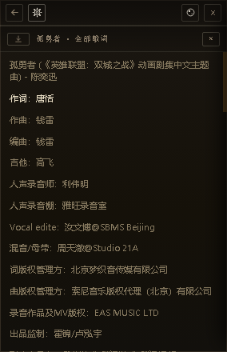
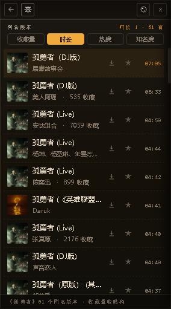

# Bonfire

一个**原生 Windows 无边框小窗音乐播放器**：pywebview（WebView2）外壳 + 单文件页面。
没有地址栏、没有多标签，就是一个 284×278 的小窗，还能缩成一颗 40px 的悬浮球挂在桌面上。

| | |
| --- | --- |
| **适配系统** | Windows 10 / 11（64 位）；Win10 需装 WebView2 Runtime |
| **程序大小** | 主程序 `Bonfire.exe` 单文件约 **12.6 MB**；安装程序约 **20.4 MB**（内含主程序 + 源码包） |
| **依赖** | 运行时零依赖（PyInstaller 打包，自带 Python）；源码运行需 `pywebview==6.2.1` |
| **许可** | MIT（见 `LICENSE`，第三方组件见 `THIRD_PARTY_NOTICES.md`） |
| **数据目录** | `%LOCALAPPDATA%\FilmMusicWindow`（状态、日志、端口）；收藏与曲库在页面 localStorage |

## 为什么打游戏时用它

- **小巧，不挡画面**：284×278 的小窗，随手压在游戏窗口一角；点一下缩成 40px 悬浮球贴屏边，连血条都不遮。
- **置顶最高**：设置里开「置顶最高」后每秒重提一次窗口，连抖音那类自己抢置顶的全屏应用也压不下去，切出去看攻略再回来，音乐还在最上层。
- **不抢键**：快捷键（空格暂停、A/← 后退、按住 D/→ 加倍速）只在鼠标悬停于窗口内时生效，游戏里按 WASD 不会误触。
- **不吃资源**：单文件 12.6 MB，后台播歌时 CPU 与内存占用都很低，开着它打游戏不掉帧。
- **一键优化顺手做**：设置 → 优化 →「一键优化」，优化网速的同时在**后台**清系统垃圾，不弹窗、不挡游戏画面。
- **想安静就藏起来**：点叉叉直接进托盘，播放不停；托盘左键或右键「显示主界面」随时叫回来。
- **便携**：运行时零依赖（Win11 自带 WebView2，Win10 装一次 Evergreen Runtime 即可），配置文件只落在 `%LOCALAPPDATA%\FilmMusicWindow`，把 exe 拷到 U 盘就能在别的机器上直接用。

## 怎么用

**装好的（推荐）**

1. 下载 `Bonfire-安装程序.exe`，双击 → 选目录（默认 `D:\Bonfire`）→ 可选桌面/开始菜单快捷方式；
2. 装完可直接启动；之后从桌面或开始菜单再开，不会重复解压；
3. 卸载走「设置 → 应用」或目录里的 `卸载 Bonfire.exe`，右键菜单也能卸载。

**从源码跑**

```powershell
pip install -r requirements.txt
python app.py
```

**上手三步**

1. 顶上搜索框打歌名，回车，7 个音源网格里挑一个，列表里点一首就播；
2. 主界面按住窗口向下拽可移动、滚轮调音量、点齿轮进设置；
3. 设置里按住窗口**向左滑**，右侧滑出一列分类（音源 / 窗口行为 / 外观 / 优化 …），点一类看一类；点 × 回去。

<p align="center">
  
  
  
</p>
<p align="center">
  
  
</p>

## 特性

**放映机外观**
- 唱片机随播放旋转（环形唱片 + 专辑封面），三行歌词在右上角
- 进度条在最上、歌名大 / 歌手小，控制台压在最下，UI 贴边不浪费像素
- 无边框 + 自绘钉子置顶按钮（置顶时钉子头朝下变白）

**搜索与音源**
- 搜一个歌名，7 个音源网格里挑，返回**同名版本列表**，按收藏量从高到低排
- 列表每行：专辑封面、歌名、歌手、收藏量、时长，点一下回主界面开播
- **列表自己挑排序**：收藏量 / 时长 / 热度 / 知名度四个按钮，列表顶上随手点，选过的记住
- 热度 = 收藏量 + 完全同名加成 + 有封面加成；知名度 = 完全同名加分、Live/翻唱/伴奏/Remix 降权，再按收藏量
- 能免费播的：网易云、酷狗（本地算 `md5(hash+kgcloudv2)` 取直链）、酷我、苹果音乐试听、**Deezer**（`api.deezer.com/search` 公开接口，带 30 秒 preview）
- QQ 音乐走游客 vkey，是能出声的真音源；Deezer 只给 30 秒预览，界面标注后自动取同名可播版本
- 严格同名一首都找不到时，会放宽到「名字含这首」的版本兜底，尽量不让整首变死号
- 一个源没版权就自动试下一个，不会卡住
- **本地同源代理** `/proxy?u=`：搜索、歌词、接口请求都走本机转发，绕开跨域和第三方代理限流
- 酷狗歌词接口取 LRC，逐行同步

**歌词**
- 三行歌词随播放**渐切滑动**（下一句从下方浮入，肉眼能看清）
- **按住鼠标上下拖**歌词切句（按住才动，松手即停），拖动后自动暂停
- 拖到哪句就停在哪句，按播放从**那一句**接着唱
- 点歌词进入**全歌词页**：一行一句、一句空一行，右上角 × 返回
- 歌词页**左上角**一键导成 txt（存进下载目录）

**下载**
- 设置里一个开关，打开后三处出现下载按钮：正在播放（**紧贴歌名右侧**）、搜索列表每行、收藏每行
- 主界面的下载按钮**平时完全隐藏**，鼠标靠近整块才半透明浮现，鼠标移到按钮上变亮
- 后端流式下载 64KB 分块，重名自动加 ` (2)`；识别 HTML 假音频、内容不足 4KB 直接判失败，绝不把网页存成 mp3
- **下载目录随便换**：设置里「下载位置」弹 Windows 原生目录选择框，选完即生效并记住；默认 `D:\音乐下载`（没 D 盘落 `Downloads\Bonfire`）

**默认播放 + 搜索模式**（都在设置里）
- **启动自动播放**：设置「启动 · 默认播放」从收藏里挑一首，每次开应用自动唱它；带 `cmd` / `play` 参数启动时不抢戏。启动时会**按歌名重新检索一次**再播，不拿上次存下的旧直链（旧链接会过期，音画会卡住）
- **搜索模式**两个口径：
  - **同名音乐**（默认）：原唱找不到时，列出其他歌手的同名版本，照旧按收藏量排
  - **网上直链**：原唱找不到时，直接向酷狗 / 酷我 / 咪咕并发抓一条**验过 200** 的直链，抓到就先播它，抓不到再退回同名列表（界面会说明「已走网上直链」）
- 设置里「优化」现在在**最底部**（原在顶部），点它照旧是关设置 → 开优化页 → 一键优化

**歌词页（独立整页）**
- 点主界面歌词 → 切到**独立的歌词整页**（窗口不变高、主界面整块收起），一行一句、一句空一行
- 页面顶部保留返回键与左上角「导出 txt」，滚轮可上下翻整首歌词
- 不再把预览接在主界面下方把窗口越拉越长：整页高度固定 434px，和优化页一致

**托盘 / 关闭行为**
- 常驻右下角托盘，图标是应用自己的 `app.ico`
- **点叉叉默认进后台**：窗口藏起来、进程和播放都不停，右下角托盘图标还在
- 托盘**右键菜单**两项：「显示主界面」把窗口叫回来（播放不中断）、「直接退出」立刻终止进程
- 设置里「窗口 · 关闭」可切换：`叉叉 → 后台`（默认）或 `叉叉 → 退出`；选择记进 `state.json`，重启仍按这个来
- 左键单击托盘图标同样能把主界面叫回来

**恢复默认**
- 设置最底部「恢复默认选项」，按下先弹确认框，点「确认恢复」才动手
- 会重置：音源、语言、背景、悬浮球、下载开关、搜索模式、默认播放、倍速、播放模式、窗口与关机行为
- **收藏和已下载的文件不动**（`film.fav.v1` 单独保留）

**收藏**
- 控制台五角星收藏、列表每行星点、点旋转播放器滑出收藏面板（右侧滑入，点空白或 × 收起）

**背景**
- 预设色卡 + 自选色
- **一个按钮通吃**：JPG / PNG / WEBP / GIF 换静态底；MP4 / WEBM 当动态底（`.win` 自动半透明让画面透出来）；MP3 / M4A / WAV 当氛围声（音量 40%）
- 媒体缓存在本机，下次打开自动恢复

**悬浮球**
- 默认关闭，设置里开；开了顶栏多一个按钮，点它整窗缩成 40px 球
- 球图标取自 app.ico 的唱片本体（金唱片 + 红点），外圈压暗到底色，40px 下没有任何浅色描边
- 拖动跟手：后端 120Hz 循环读光标 + `SetWindowPos`，不是页面发增量
- 点一下球回来（位移 < 6px 判为 tap）
- `SetWindowRgn` 圆形裁剪 + `DwmSetWindowAttribute` 关掉系统圆角与 1px 描边 → 球外没有白框
- **自动靠边**：松手后贴到离它最近的屏幕边（左/右/上/下，10px 内边距），设置里可关
- **自动置顶**：缩成球时自动保持最前，回到主界面恢复原来的钉子状态（不会偷改用户的置顶设置），设置里可关

**窗口行为**
- **不出屏**：主窗被拖到屏幕外（或换了分辨率）时，自动挪回最近的可见位置，设置里可关
- **持续监控**：后台每 1.2s 盯一次窗口（球该贴边就贴边、主窗该回屏内就回屏内），所以**一启动就生效**，不用先手动开关一次
- 两个开关都在设置的「行为」分组，状态记在 `state.json`，重启还在

**缓存**
- 设置里「缓存」分组：显示当前缓存目录与占用，一键**清理缓存**（背景媒体 + 酷狗直链缓存 + 日志），清完立刻回显释放了多少
- **缓存位置可换**：Windows 原生目录选择框选任意盘，选完把旧背景一起搬过去并记住
- 默认 `%LOCALAPPDATA%\FilmMusicWindow`

**使用说明**
- 设置里「使用说明」按钮，点开是满屏说明面板：播放、快捷键、歌词、收藏、音源、排序、下载、背景、小窗与球、缓存，十节全在，可滚

**多文字界面**
- 设置里的「语言」是一个**地球图标按钮**，点开是 19 项文字网格，选中立刻换整个界面
- 中文、英语、日语、韩语、朝鲜语、阿拉伯语、希伯来语、越南语、藏文、宗卡文、格鲁吉亚语、塔塔尔文、凉山彝语、傈僳文、德宏傣文、奥赛治语、古突厥文、佉卢文、塞浦路斯文字
- 阿拉伯语 / 希伯来语 / 佉卢文自动切 RTL 排版
- 每项都写着中文名，即使系统缺字体、原生名渲染成方框也能点对；缺字体的会标「需字体」

**其他**
- 倍速 0.75 / 1 / 1.25 / 1.5 / 2（无边框竖排小菜单）、单曲循环 / 顺序播放
- 19 种文字界面（地球按钮在设置里）
- 窗口内滚轮调音量、A/← 后退 5s、按住 D/→ 2 倍速、空格暂停（都在鼠标悬停于窗口内时生效）
- 对外 HTTP 接口 + 指令通道，任何 AI / 脚本都能推歌、切视图、开关功能（见下）

## 运行

```powershell
pip install pywebview==6.2.1
python app.py
```

需要 Windows 10/11 + **WebView2 Runtime**（Win11 自带；Win10 可从微软官网装 Evergreen Runtime）。

## 打包成 exe

```powershell
pip install pyinstaller
.\build.ps1
# 产物：dist\Bonfire.exe（单文件，约 12.6 MB）
```

或手动：

```powershell
python -m PyInstaller --noconfirm --onefile --noconsole `
  --name "Bonfire" --icon app.ico `
  --add-data "index.html;web" --distpath dist --workpath _build --specpath _build app.py
```

## 目录

```
app.py            pywebview 外壳 + 本地 HTTP 服务 + Win32 窗口控制 + 音源/下载/背景接口
index.html    全部 UI（CSS/JS 内联，单文件，无外部依赖）
app.ico           应用图标（悬浮球也用这个）
build.ps1             打包脚本
```

窗口尺寸由内容决定：主视图 284×278、列表 284×514、歌词页 284×440、球 40×40
（`app.py` 顶部的 `WIN_W/WIN_H` 只是初始值，页面通过 `/resize?h=` 按内容高度回调）。

## AI 操控 / 自动化

本地服务默认在 `127.0.0.1:8777`，实际端口写在 `%LOCALAPPDATA%\FilmMusicWindow\port.txt`。

| 接口 | 用途 |
| --- | --- |
| `GET /push?cmd=<指令>` | 排队一条指令，页面下一轮心跳取走 |
| `GET /next` | 页面侧取指令 |
| `GET /stat` | 当前状态（在播歌名、音源、视图、收藏数、球模式、下载开关…） |
| `GET /api` | 接口与指令清单 |
| `GET /ball?on=1` | 缩成球 / 还原 |
| `GET /set_top?on=1` | 置顶 |
| `GET /opt?ball_snap=&win_keep=&snap_now=1` | 球自动靠边 / 主窗不出屏的开关 |
| `GET /resize?h=` | 按内容高度调窗口 |
| `GET /proxy?u=` | 本地同源代理 |
| `GET /qqsearch?w=<歌名>` | QQ 音乐检索，并附上能试听的直链（`play` 为 1 即可播） |
| `GET /qqurl?mid=<songmid>` | 单曲取 QQ 游客试听地址，付费曲返回空串 |
| `GET /fallback?q=<歌名>` | 付费曲兜底：并发问酷狗/酷我/咪咕，返回验过 200 的 mp3 直链 |
| `GET /download?url=&name=&ext=` | 下载直链音频 |
| `GET /dlpath` | 查当前下载目录 |
| `GET /dlpath?p=<目录>` | 直接设置下载目录 |
| `GET /dlpick` | 弹目录选择框，选完即设为下载目录 |
| `GET /openfolder` | 打开下载目录 |
| `POST /bgup` | 上传本地图片/视频/音频当背景（原始 body） |
| `GET /bgmedia` | 流播背景媒体（支持 Range） |
| `POST /txt?name=` | 纯文本落盘（歌词导出用） |

指令举例：`__search_list`、`__row_0`、`__play_now`、`__next_song`、`__set_dl_on`、`__dl_current`、
`__open_lyr`、`__close_lyr`、`__lyr_dl`、`__lyr_next`、`__lyr_prev`、`__dl_dir_<路径>`、
`__bgm_local`、`__click_ball`、`__toggle_ball_feature`、`__src_netease`、`__lang_en` …
完整清单见 `GET /api`。

日志在 `%LOCALAPPDATA%\FilmMusicWindow\api.log`。

## QQ 音乐直连（重点音源）

QQ 音乐在本项目里已经不是「检索源」，而是**能出声的真音源**，走的是平台自己给游客的公开链路：

1. 检索：`c.y.qq.com/soso/fcgi-bin/client_search_cp`（网页版搜索框用的同一个接口），单次 30 条，带 `songmid / media_mid / interval / pay`。
2. 试听：`u.y.qq.com/cgi-bin/musicu.fcg` 的 `vkey.GetVkeyServer / CgiGetVkey`，`uin` 固定 `0`（游客），返回 `sip + purl` 拼出真实音频地址。
3. 列表里每首歌的 QQ 直链会**提前挂到行上**；点播放时再按 `songmid` 现取一次（链接有有效期，缓存 10 分钟）。

实测「孤勇者」30 条同名里 6 条能直连出声（HTTP 200 / `audio/mp4`）。

`pay.payplay = 1` 的付费曲，平台**本身不返回 purl**——这里没有伪造 uin、没有解密、没有盗链，而是直接走**付费曲兜底**：本地服务并发去酷狗、酷我、咪咕找同名版本，每个候选都实测过一次 `Range: bytes=0-1023` 拿到 200 才交给播放器（实测 0.6–0.9 秒返回）。所以付费曲点下去照样有声音，出声的是别家的同名可播版本。

`GET /fallback?q=<歌名>` 就是这个兜底接口，返回 `{url, src, name}` 列表，页面在 QQ 拿不到地址时直接用它起播。

另外修了一个会影响「点了没声」的老 bug：候选源补全时先把新源 push 进 `state.srcs` 再判断是否为空，结果永远不进 `loadSrc`。现在改成先判空再起播，兜底源也会先单独跑一次，不必等 meting / Deezer 全部返回。

## 歌词同步：按版本对时长，跨版本等比缩放

歌词错位在「悬浮球听一会再回主界面」后面才被注意到，根因有三层，都修了：

1. **挑歌词不看时长**：以前直接取酷狗 `krcs` 的第一条候选。同一个歌名下挂着原版（4:16）、DJ 版（2:37）、Live 版，第一句能差十几秒。现在把**正在播放那版的真实时长**发给服务端，由服务端按 `|candidate.duration - dur|` 取最接近的一条，并把选中的时长回传（`out.dur`）当锚点。
2. **换曲瞬间的竞态**：`audio.duration` 在 `src` 换掉、`loadedmetadata` 之前仍然是上一首的。旧代码拿它去挑歌词，挑来的自然是上一首那版的歌词。现在只有当 `state.durRow === 当前行` 时才信 `audio.duration`，否则先用列表里的标称时长；等 `loadedmetadata` 一到，真实时长和请求时长差超过 8 秒就**按真实时长重取一次**。
3. **不同版本仍然对不上**：取到的歌词与音频版本时长差 6 秒以上时，按 `audio.duration / 歌词版本时长` 把整条时间轴**等比缩放**，换源（`nextSrc`）触发 `loadedmetadata` 时再校一次。

另外两个显示层的小毛病一起修了：首句之前（`lrcIdx = -1`）以前会因为「索引没变」而跳过重绘，界面一直挂着「暂无歌词」；现在 `-1` 也会重绘，进入第一句前显示首句。

排障接口：`/stat` 新增 `li`（当前歌词行号）与 `ld`（缩放后的歌词轴总长），`/lyric` 新增回传 `dur`（选中歌词版本自报的时长）。

## 音源收敛到 7 个

`spotify / tidal / qobuz / joox / soundcloud / streetvoice / soda / qianqian / fiveSing / jamendo / migu` 这 11 个平台都在本轮被删掉了 —— 它们本身不给免鉴权直链（要 OAuth、token 或 client_id），留着只能是一个「点了不出声」的格子。现在设置里只剩：

`自动 / 网易云 / QQ音乐 / 酷狗 / 酷我 / 苹果音乐 / Deezer`

- QQ 音乐是能出声的真音源（游客 vkey + 付费曲同名兜底）；
- 网易云、酷狗、酷我、苹果走各自的公开检索 + 试听接口；
- Deezer 官方只给 30 秒预览，界面会如实标注，点下去播放同名可播版本。

后端 `SRC_LIST` 与页面 `SRC_PREFS / SRC_LABEL / SRC_VIA` 三处同步收口，`/srcs` 现在返回 7 条。

## 优化页：把 Pavise 那套调度搬进播放器

设置里新增「一键优化」按钮，按下去先跑一遍网速优化，然后直接切到优化页（窗口从 278px 长到 384px，比主播放页略高，内部可滚）。页面按 [Pavise](https://github.com/) 的调度思路做了用户态等价物：

| 区块 | 做了什么 | 接口 |
| --- | --- | --- |
| 模式 | 常规 / 竞技 / 自定义，竞技模式把本进程钉在「高」优先级 | `/boost/mode?m=` |
| 后台治理 | 关 / 正常 / 激进：把符合条件的后台进程降到 below normal 或 idle，白名单保护 system/smss/csrss/winlogon/services/lsass/svchost/dwm/explorer/audiodg/python/本程序；关档按记录的原值逐条回滚 | `/boost/bg?l=0|1|2` |
| 极限清理 | 用户临时目录 / 系统临时目录 / 播放器缓存（含 api.log），可勾选连回收站；清完刷 DNS | `/boost/clean?items=` |
| 性能优先级 | 普通 / 高于正常 / 高 | `/boost/prio?p=` |
| 核心分配 | 全核 / 仅性能核（按注册表每核标称主频认定，≥最高频 92%） / 禁超线程（保留偶数核） | `/boost/cores?m=all|pcore|noht` |
| 网络 | 刷 DNS 缓存、TCP autotuninglevel=normal、开 ECN，并对 4 个音乐接口做 3 次 TCP 握手取最快 | `/boost/net` |

实测（本机 16 逻辑核 / 1.3GB 临时文件）：清理释放 1.3GB 报数正确、后台治理降级 68 个进程后 `l=0` 全部恢复为原优先级、核心掩码 16/16 与 pcore 切换 `ok`、四站延迟 12–53ms。

### 第二版补齐的项

第一版只有清理 / 优先级 / 核心 / 后台 / 网络五块，对着 `Pavise.exe` 里的符号表（`TimerResolutionLease`、`GlobalTimerResTweak`、`StandbyCleanerEngine`、`MemoryCleanupButton`、`GameMode`、`LaptopPerfMode`、`DwmBoost`、`IfeoBoost`、`CoreIsolationEngine`、`BackgroundYieldCpuSetIds` …）逐条比对后又补了：

| 项 | 做法 | 接口 |
| --- | --- | --- |
| 计时器精度 | `timeBeginPeriod(1)` / 退出自动 `timeEndPeriod` | `/boost/timer?on=` |
| 内存清理 | 全进程 `EmptyWorkingSet` + `NtSetSystemInformation(80, purgeStandbyList)` | `/boost/mem` |
| 游戏模式 | 写 `HKCU\Software\Microsoft\GameBar\AutoGameModeEnabled` | `/boost/game?on=` |
| 电源计划 | `powercfg /setactive SCHEME_MIN \| SCHEME_BALANCED` | `/boost/power?plan=` |
| 桌面合成提速 | `dwm.exe` 提到「高」，可恢复原优先级 | `/boost/dwm?on=` |
| 核心隔离 | 后台进程亲和限制到尾部 1/4 核，关闭按原掩码逐个恢复 | `/boost/iso?on=` |
| 指定程序优先级 | 写 `IFEO\<exe>\PerfOptions\CpuPriorityClass`（要管理员） | `/boost/ifeo?exe=&p=` |

### 顺手修的延迟

优化页原来每次刷新都会 `os.walk` 一遍 1.3GB 的临时目录 + 对 4 个站点各做 3 次 TCP 握手，点一下要等好几秒，这就是「按键有延迟」。

- `/boost/scan` 单独成接口，扫描结果缓存 8 秒，打开页面先出状态、扫描在后台跑；
- 延迟数据缓存 120 秒，只有点「一键优化网速 / 重测延迟」才重新握手；
- `/boost` 现在只读内存里的状态，实测 20–70ms；按钮按下立即置灰并显示进行中文案。

实测：`/boost` 20–70ms、定时器 6ms、游戏模式 13–109ms、核心隔离开 23ms / 关 53ms、内存清理 0.7–1.5s、扫描 1.2s（后台）。

### Pavise 功能对照表（逐项）

| Pavise 里的功能 | 这里的实现 | 位置 |
| --- | --- | --- |
| TimerResolutionLease / GlobalTimerResTweak | `timeBeginPeriod(1)` + 退出时 `timeEndPeriod` | 计时器精度 |
| MemoryCleanupButton / StandbyCleanerEngine | `EmptyWorkingSet` 全量非关键进程 + `NtSetSystemInformation(SystemMemoryListInformation)` 清 standby | 内存清理 |
| GameMode | HKCU GameBar 三键 | 系统开关 |
| LaptopPerfMode / PowerLimit | `powercfg /setactive` 高性能 / 平衡 | 系统开关 |
| DwmBoost / DWM 相关 | `dwm.exe` 提到 HIGH 优先级，可恢复 | 系统开关 |
| CoreIsolationEngine / BackgroundYieldCpuSetIds | 后台进程亲和收紧 + 回滚原始掩码 | 核心隔离 / 后台治理 |
| IfeoBoost | `Image File Execution Options\<exe>\PerfOptions\CpuPriorityClass`，按原值还原 | 指定程序优先级 |
| **IrqPriorityTweak** | `...\Interrupt Management\Affinity Policy\DevicePriority`（写前备份原值） | 设备中断 · IRQ 优先级 |
| **MsiModeTweak** | `...\MessageSignaledInterruptProperties\MSISupported` | 设备中断 · MSI 模式 |
| **NetworkAffinityTweak** | `DevicePolicy=4` + `AssignmentSetOverride`（8 字节 CPU 掩码） | 设备中断 · 中断亲和 |
| **FrameLimit / RTSS 联动** | 检测 RTSS，写 `Profiles\Global` 的 `Limit=`；没装就明说没装 | 帧率限制（RTSS） |
| **LolAddonCleaner** | 扫 C/D/E/F 盘的 LoL / WeGame 安装，只清 Logs / TencentDL 等缓存目录 | 游戏插件清理 |
| **AntiCheatMode** | Vanguard / EAC / BattlEye / ACE / nProtect 加进保护名单，后台治理与隔离跳过 | 反作弊兼容 |

覆盖 17 项。两项前置条件如实写在界面上：**写 HKLM（MSI / IRQ / 亲和 / IFEO）要管理员**（卡片里就有「以管理员重启（解锁写权限）」，走 UAC）；**帧率限制依赖 RTSS**（Pavise 自己也是装 RTSS 来实现的，没装时这里不假装成功）。


## 设置：分类抽屉 · 毛玻璃 · 圆润边框

设置不再是一整页密密麻麻的开关，顶栏只留「‹ 返回分类 / 标题 / ×」：

- **标签藏起来**：打开设置先看到一页提示，按住窗口向左滑，右侧滑出一列分类（音源 / 悬浮球 / 搜索方式 / 启动播放 / 缓存 / 窗口行为 / 关闭与多开 / 语言 / 外观 / 下载 / 优化 / 恢复默认 / 关于），点一类，列表滑回去、显示这一类的内容；向右滑或点列表外的空白处都能收回去；点 × 直接回主界面。
- **毛液态玻璃**：外观页里「开启」右侧一根进度条，往右拉模糊越重（2–28px，实时预览），关掉就回到纯实心底；设置、列表、歌词页、收藏面板都会透出背景。
- **圆润边框**：同样一根进度条控制整窗圆角（4–32px），走 `SetWindowRgn + CreateRoundRectRgn` 真裁窗口，四角直接透出桌面；裁完会重新按掉 DWM 画的那圈 1px 亮边，所以没有白框。关闭时进度条自动隐藏。
- **全站滚动条都不显示**（列表、歌词、优化页、设置都还能滚，只是不画那条轨道）。

## 单实例 / 多开

默认只允许开一个 `Bonfire.exe`：

- 启动时先 `CreateMutexW("Bonfire_SingleInstance")`，`GetLastError()==183` 说明已有实例；
- 再扫 8777–8779 的 `/api` 认人（只认 `name` 里带 Bonfire 的），找到就 `/tray/show` 把它的窗口叫回来，本进程 `os._exit(0)`；
- 设置「窗口 · 多开」切到「允许多开」后跳过互斥，第二个实例各占一个端口（8727–8779 / 随机），各写一份 `port_<pid>.txt`，也不顶掉 `port.txt`；
- Windows 的 `SO_REUSEADDR` 会让第二个实例「绑上」已占端口，所以起服务前先用 `socket.create_connection` 探一遍，占到就换下一个；
- 多开实例各用各的 WebView2 数据目录（`profile_<pid>`），否则第二个会被同一个 profile 卡住。

## 真正没做的（驱动 / 内核层）

## 许可

Bonfire 以 **MIT** 发布，见 `LICENSE`。运行时依赖（pywebview、pythonnet、Pillow 等）的许可、
以及「不分发第三方安装包 / 音源内容」的边界，都写在 `THIRD_PARTY_NOTICES.md`。

二次分发请保留这两个文件；引用新的第三方库前，先确认它允许再分发（MIT / BSD / Apache-2.0 可以，
GPL / AGPL 会传染整个项目，CC-BY-NC、SSPL、Commons Clause 不属于开源许可）。
